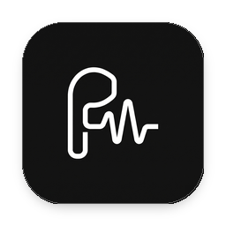
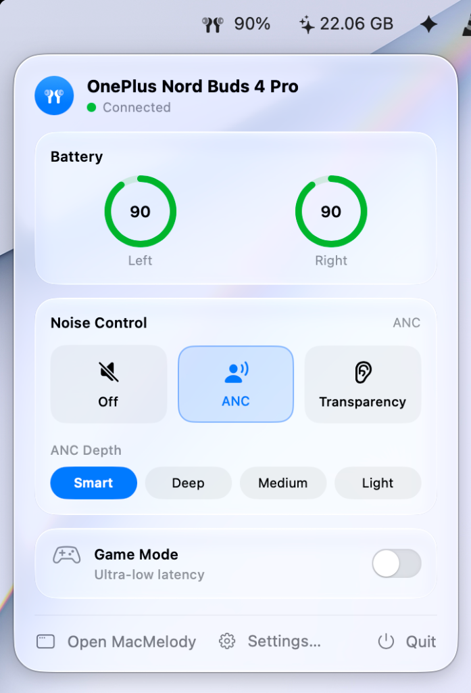
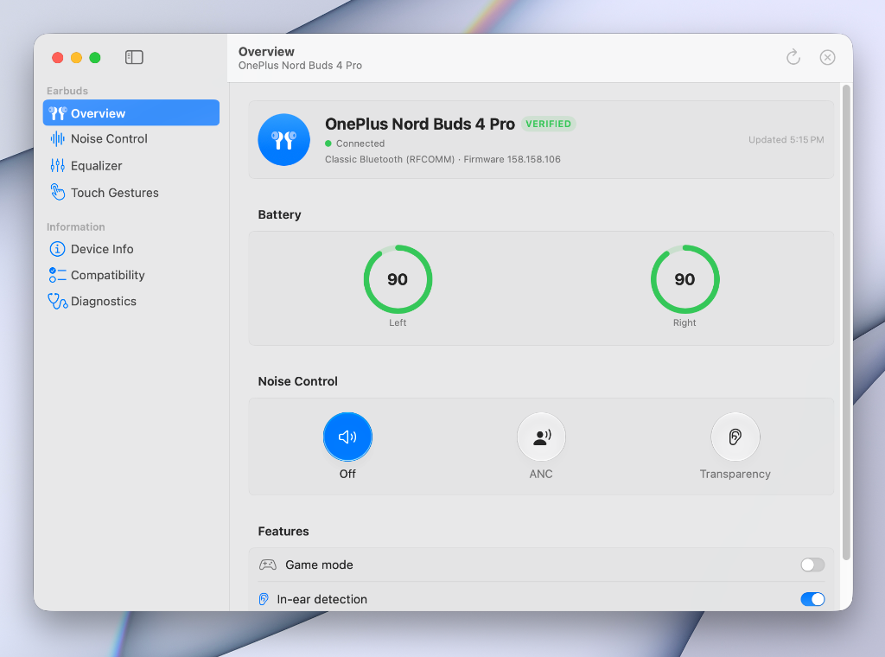

<div align="center">



# MacMelody

### Elegant macOS Menu Bar Companion for OnePlus, OPPO & realme Earbuds

Experience seamless audio control on your Mac without opening mobile apps or cloud services. Designed natively for macOS Sonoma & Sequoia with fluid Apple Liquid Glass aesthetics.

[](https://apple.com/macos)
[](https://swift.org)
[](https://apple.com)
[](LICENSE)
[](https://github.com/Omraj09/MacMelody/releases/latest)

<br/>

<a href="https://github.com/Omraj09/MacMelody/releases/latest/download/MacMelody.dmg">
  
</a>

<br/><br/>

<p align="center">
  
  
</p>

</div>

<br/>

---

## 🌟 Key Highlights

- **🪟 Apple Liquid Glass Interface**  
  A custom, borderless floating panel powered by AppKit and SwiftUI. Features genuine macOS vibrant material translucency with smooth continuous rounded corners.
- **🌸 Spring Bloom Motion**  
  Polished, native entrance animation blooming smoothly downward from your menu bar icon when opened.
- **🔽 Downward-Only Adaptive Expansion**  
  Toggling Active Noise Cancellation (ANC) seamlessly expands the panel downwards in perfect lockstep synchronization—no jumping, clipping, or upward movement.
- **🎛️ Full Noise Management**  
  Instantly toggle between **Off**, **Transparency**, and **Active Noise Cancellation**, with quick depth selection (**Smart**, **Deep**, **Medium**, and **Light**).
- **⚡ Ultra-Low Latency Game Mode**  
  One-click low-latency audio transmission mode optimized for gaming, video editing, and live streams.
- **🔋 Independent Battery Diagnostics**  
  Live battery percentage rings and charging status for Left bud, Right bud, and the charging Case.
- **🎵 Spatial Audio & Bass Enhancement**  
  Direct hardware hooks for Spatial Audio and BassWave algorithms on supported models.
- **🛡️ 100% Private, Local & Offline**  
  Direct Bluetooth RFCOMM and BLE communication. Zero background telemetry, zero network tracking, and no external accounts required.

---

## 🎧 Supported Earbud Models

| Model | Compatibility | Verified Features |
|---|:---:|---|
| **OnePlus Nord Buds 4 Pro** (`066814`) | 🟢 **Full Support** | Battery monitoring, ANC (Smart / Deep / Medium / Light), Transparency, Game Mode, Spatial Audio, BassWave |
| **OnePlus Buds 3** (`063C14`) | 🟢 **Full Support** | Live battery, ANC modes & levels, Equalizer presets, Game Mode, In-ear detection, Touch gesture controls |
| **OnePlus Nord Buds 3 Pro** (`064414`) | 🟢 **Supported** | Battery status, Noise control modes, low-latency mode |
| **realme Buds Air 5** (`062012`) | 🟢 **Supported** | Multi-level ANC, battery status, realme EQ curves |
| **realme Buds T300** (`062412`) | 🟢 **Supported** | Core noise control (Off / ANC / Transparency), battery |
| **OPPO Enco Series (OPO Protocol)** | 🟡 **Compatible** | Battery and standard noise control profiles |

---

## 📥 Installation

### Method 1: Direct Download (Easiest)

1. Download the latest release: **[MacMelody.dmg](https://github.com/Omraj09/MacMelody/releases/latest/download/MacMelody.dmg)**
2. Open `MacMelody.dmg` and drag **MacMelody** into your **Applications** folder.
3. Launch **MacMelody**. When macOS prompts for Bluetooth access, click **Allow**.
4. Connect your earbuds to your Mac via Bluetooth, and MacMelody will automatically detect and link to them.

### Method 2: Build from Source

Requirements: macOS 14.0+, Xcode Command Line Tools (`xcode-select --install`), and Swift 6.

```bash
# 1. Clone the repository
git clone https://github.com/Omraj09/MacMelody.git
cd MacMelody

# 2. Build and install to /Applications
./scripts/build-app.sh --install

# 3. (Optional) Package a clean DMG
./scripts/build-dmg.sh
```

---

## ⌨️ Global Keyboard Shortcuts

| Shortcut | Action |
|:---:|---|
| <kbd>⌘</kbd> + <kbd>1</kbd> | Switch Noise Control to **Off** |
| <kbd>⌘</kbd> + <kbd>2</kbd> | Switch Noise Control to **Active Noise Cancellation** |
| <kbd>⌘</kbd> + <kbd>3</kbd> | Switch Noise Control to **Transparency** |
| <kbd>⌘</kbd> + <kbd>,</kbd> | Open App Settings & Diagnostics |
| <kbd>⌘</kbd> + <kbd>Q</kbd> | Quit MacMelody |

---

## 🏗️ Architecture

MacMelody is engineered in Swift 6 with strict concurrency checking across modular packages:

```
MacMelody
├── Sources
│   ├── OneBudsApp          # SwiftUI Views, Liquid Glass NSPanel, Popover animations
│   ├── OneBudsCore         # OPOv1 Session actor, DeviceManager, DeviceRegistry
│   ├── OneBudsBluetooth    # IOBluetooth RFCOMM & CoreBluetooth transports
│   ├── OneBudsProtocol     # Clean-room OPO frame codec & reply parsers
│   └── OneBudsDiagnostics  # Bluetooth inspection & export tools
└── Packaging               # App bundle metadata, icons, and DMG styling
```

- **Single-Use Transports:** Every disconnect cleans up connection memory to prevent stale state.
- **Hardware-Acknowledged Feedback:** UI changes only update when the physical hardware returns confirmation.

---

## 🔒 Privacy & Security

- **No Network Permissions:** MacMelody does not include networking capabilities or URL sessions.
- **Local Storage Only:** Preferences are persisted purely via local macOS `UserDefaults`.
- **Packet Redaction:** Any diagnostics export automatically redacts Bluetooth MAC addresses and private device identifiers.

---

## 📄 License & Disclaimer

Developed and maintained by **[Omraj Sawant](https://github.com/Omraj09)**.

Released under the [MIT License](LICENSE).

*Disclaimer: MacMelody is an independent native open-source utility and is not affiliated with, authorized, or endorsed by OnePlus, OPPO, realme, or Apple Inc.*
